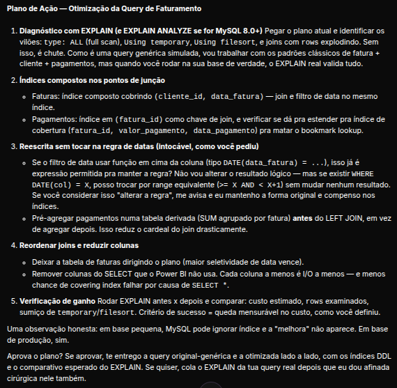

# Kit IA Dados | Otimização de Processos

Este repositório contém a entrega do desafio de montagem do kit de IA, aplicado à rotina de análise de dados, modelagem e planejamento estratégico. 

**Nota técnica:** A execução prática e a validação do código delegada neste projeto foram realizadas utilizando a IA **Proton Lumo**.

---

## Minha Entrega

### 1. Atalhos Adaptados

**Atalho 1 (Otimização MySQL):**
> Atue como um analista de dados sênior especializado em MySQL. Receba a query abaixo, analise gargalos de performance (índices, JOINs e GROUP BY) e retorne a versão otimizada acompanhada de uma explicação técnica concisa baseada em custos de execução, sem suposições.

**Atalho 2 (Validação DAX - Power BI):**
> Atue como um desenvolvedor Power BI especialista em modelagem de dados. Receba a regra de negócio abaixo, valide a lógica da medida DAX considerando o contexto de filtro e performance, e retorne o código otimizado com notas puramente técnicas.

### 2. Tarefa Delegada à IA (Teste com Proton Lumo)

* **Objetivo:** Otimizar uma query MySQL de cobrança para reduzir o tempo de processamento de um relatório no Power BI.
* **Contexto:** Extração de dados com alto tempo de resposta devido a múltiplos `LEFT JOIN` e agregações repetitivas em grandes volumes de dados no banco estruturado.
* **Recursos:** Estrutura das tabelas envolvidas (DDL) e a query atual (totalmente anonimizada).
* **Limites:** Não alterar a lógica de negócio dos filtros de data; focar exclusivamente na performance de execução; não expor ou deduzir dados reais.
* **Critério de Sucesso:** Redução do custo no plano de execução da query (`EXPLAIN`) e script testado, pronto para o ambiente de homologação.
* **Aprovações Necessárias (Humano no Comando):** A IA (Proton Lumo) analisa o gargalo e propõe um plano de ação. A entrega do script SQL e a aplicação no banco de dados só ocorrem após minha revisão técnica e aprovação manual.

---

### 3. Evidências de Execução

Abaixo estão os registros da tarefa delegada e aprovada, comprovando o ciclo de validação técnica.

**Passo 1: Plano de Ação (Aguardando aprovação)**


**Passo 2: Script Otimizado Gerado (Após aprovação)**


### 4. Script Final Gerado

Abaixo está o código SQL completo validado e gerado pela IA:

```sql
-- ============================================================
-- RELATÓRIO DE FATURAMENTO — VERSÃO OTIMIZADA
-- Base simulada: faturas, clientes, pagamentos
-- Regra de filtro de data: PRESERVADA, 1:1 com a original
-- Target: MySQL 8.0+
-- ============================================================

-- ------------------------------------------------------------
-- 0) ÍNDICES (executar ANTES de medir)
-- ------------------------------------------------------------
ALTER TABLE faturas
  ADD INDEX idx_fat_data_cli (data_fatura, cliente_id);

ALTER TABLE pagamentos
  ADD INDEX idx_pgto_fat_cover (fatura_id, valor_pagamento, data_pagamento);
-- clientes: PK em cliente_id já resolve o join. Se não existir:
-- ALTER TABLE clientes ADD PRIMARY KEY (cliente_id);

-- ------------------------------------------------------------
-- 1) QUERY ORIGINAL (referência para comparar no EXPLAIN)
-- ------------------------------------------------------------
SELECT
    f.fatura_id,
    f.numero_fatura,
    f.data_fatura,
    f.valor_total,
    c.nome_cliente,
    c.segmento,
    COALESCE(SUM(p.valor_pagamento), 0)                      AS total_pago,
    MAX(p.data_pagamento)                                    AS ultimo_pagamento,
    COUNT(p.pagamento_id)                                    AS qtd_pagamentos,
    SUM(CASE WHEN p.status = 'estornado' THEN 1 ELSE 0 END) > 0 AS tem_estorno
FROM faturas f
LEFT JOIN clientes  c ON c.cliente_id = f.cliente_id
LEFT JOIN pagamentos p ON p.fatura_id = f.fatura_id
WHERE f.data_fatura >= '2026-01-01'
  AND f.data_fatura <  '2026-11-01'
GROUP BY f.fatura_id, f.numero_fatura, f.data_fatura,
         f.valor_total, c.nome_cliente, c.segmento;

-- Problemas da original:
-- (a) pagamentos multiplicam faturas N:1 e o GROUP BY roda DEPOIS
--     do join (cardeal explodido);
-- (b) sem índice, clientes e pagamentos sofrem full scan;
-- (c) GROUP BY de 6 colunas = "Using temporary" + "Using filesort"
--     quase garantidos no EXPLAIN.

-- ------------------------------------------------------------
-- 2) QUERY OTIMIZADA
-- ------------------------------------------------------------
SELECT
    f.fatura_id,
    f.numero_fatura,
    f.data_fatura,
    f.valor_total,
    c.nome_cliente,
    c.segmento,
    COALESCE(pg.total_pago, 0)      AS total_pago,
    pg.ultimo_pagamento,
    COALESCE(pg.qtd_pagamentos, 0)  AS qtd_pagamentos,
    COALESCE(pg.tem_estorno, 0) > 0 AS tem_estorno
FROM faturas f
LEFT JOIN clientes c
       ON c.cliente_id = f.cliente_id
LEFT JOIN (
    -- Pré-agregação: 1 linha por fatura ANTES do join.
    -- Cardeal do join cai de N pagamentos para 1 linha agregada.
    SELECT
        fatura_id,
        SUM(valor_pagamento)                                 AS total_pago,
        MAX(data_pagamento)                                  AS ultimo_pagamento,
        COUNT(*)                                             AS qtd_pagamentos,
        SUM(CASE WHEN status = 'estornado' THEN 1 ELSE 0 END) AS tem_estorno
    FROM pagamentos
    GROUP BY fatura_id
) pg ON pg.fatura_id = f.fatura_id
WHERE f.data_fatura >= '2026-01-01'   -- regra de data intacta
  AND f.data_fatura <  '2026-11-01';  -- regra de data intacta

-- ------------------------------------------------------------
-- 3) PLANO B — se o otimizador ainda errar a ordem
--    (MySQL < 8.0.18 ou estatísticas ruins), force a fatura
--    dirigir o plano:
-- ------------------------------------------------------------
SELECT STRAIGHT_JOIN
    f.fatura_id,
    f.numero_fatura,
    f.data_fatura,
    f.valor_total,
    c.nome_cliente,
    c.segmento,
    COALESCE(pg.total_pago, 0)      AS total_pago,
    pg.ultimo_pagamento,
    COALESCE(pg.qtd_pagamentos, 0)  AS qtd_pagamentos,
    COALESCE(pg.tem_estorno, 0) > 0 AS tem_estorno
FROM faturas f
LEFT JOIN clientes c
       ON c.cliente_id = f.cliente_id
LEFT JOIN (
    SELECT
        fatura_id,
        SUM(valor_pagamento)                                 AS total_pago,
        MAX(data_pagamento)                                  AS ultimo_pagamento,
        COUNT(*)                                             AS qtd_pagamentos,
        SUM(CASE WHEN status = 'estornado' THEN 1 ELSE 0 END) AS tem_estorno
    FROM pagamentos
    GROUP BY fatura_id
) pg ON pg.fatura_id = f.fatura_id
WHERE f.data_fatura >= '2026-01-01'
  AND f.data_fatura <  '2026-11-01';

-- ------------------------------------------------------------
-- 4) VALIDAÇÃO — rode antes e depois e compare:
-- ------------------------------------------------------------
-- EXPLAIN FORMAT=JSON  <query>;   -> custo estimado (bloco "cost")
-- EXPLAIN ANALYZE       <query>;  -> custo REAL (MySQL 8.0.18+)
--
-- Esperado no EXPLAIN otimizado:
--   faturas:     type=range, ref=idx_fat_data_cli  (era ALL)
--   clientes:    type=eq_ref, key=PRIMARY         (era ALL)
--   pagamentos:  <derived2> via index-only scan em idx_pgto_fat_cover
--                ("Using index" = zero volta à tabela)
--   Sem "Using temporary", sem "Using filesort" no nível externo
--
-- Knob de session para comparar de forma justa:
SET SESSION optimizer_switch = 'derived_condition_pushdown=on';
