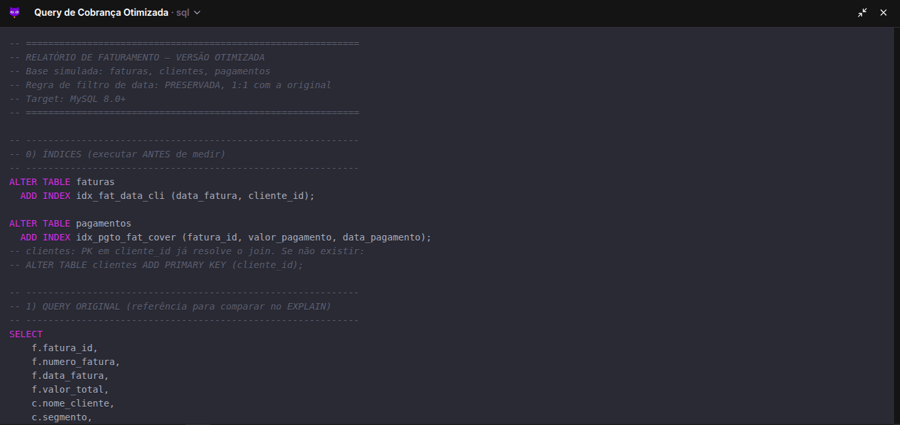

# Kit IA Dados | Otimização de Processos

Este repositório contém a entrega do desafio de montagem do kit de IA, aplicado à rotina de análise de dados, modelagem e planejamento estratégico. 

**Nota técnica:** A execução prática e a validação do código delegada neste projeto foram realizadas utilizando a IA **Proton Lumo**.

---

## Minha Entrega

### 1. Atalhos Adaptados

**Atalho 1 (Otimização MySQL):**
> Atue como um analista de dados sênior especializado em MySQL. Receba a query abaixo, analise gargalos de performance (índices, JOINs e GROUP BY) e retorne a versão otimizada acompanhada de uma explicação técnica concisa baseada em custos de execução, sem suposições.

**Atalho 2 (Validação DAX - Power BI):**
> Atue como um desenvolvedor Power BI especialista em modelagem de dados. Receba a regra de negócio abaixo, valide a lógica da medida DAX considerando o contexto de filtro e performance, e retorne o código otimizado com notas puramente técnicas.

### 2. Tarefa Delegada à IA (Teste com Proton Lumo)

* **Objetivo:** Otimizar uma query MySQL de cobrança para reduzir o tempo de processamento de um relatório no Power BI.
* **Contexto:** Extração de dados com alto tempo de resposta devido a múltiplos `LEFT JOIN` e agregações repetitivas em grandes volumes de dados no banco estruturado.
* **Recursos:** Estrutura das tabelas envolvidas (DDL) e a query atual (totalmente anonimizada).
* **Limites:** Não alterar a lógica de negócio dos filtros de data; focar exclusivamente na performance de execução; não expor ou deduzir dados reais.
* **Critério de Sucesso:** Redução do custo no plano de execução da query (`EXPLAIN`) e script testado, pronto para o ambiente de homologação.
* **Aprovações Necessárias (Humano no Comando):** A IA (Proton Lumo) analisa o gargalo e propõe um plano de ação. A entrega do script SQL e a aplicação no banco de dados só ocorrem após minha revisão técnica e aprovação manual.

---

### 3. Evidências de Execução

Abaixo estão os registros da tarefa delegada e aprovada, comprovando o ciclo de validação técnica.

**Passo 1: Plano de Ação (Aguardando aprovação)**

**Passo 2: Script Otimizado Gerado (Após aprovação)**

